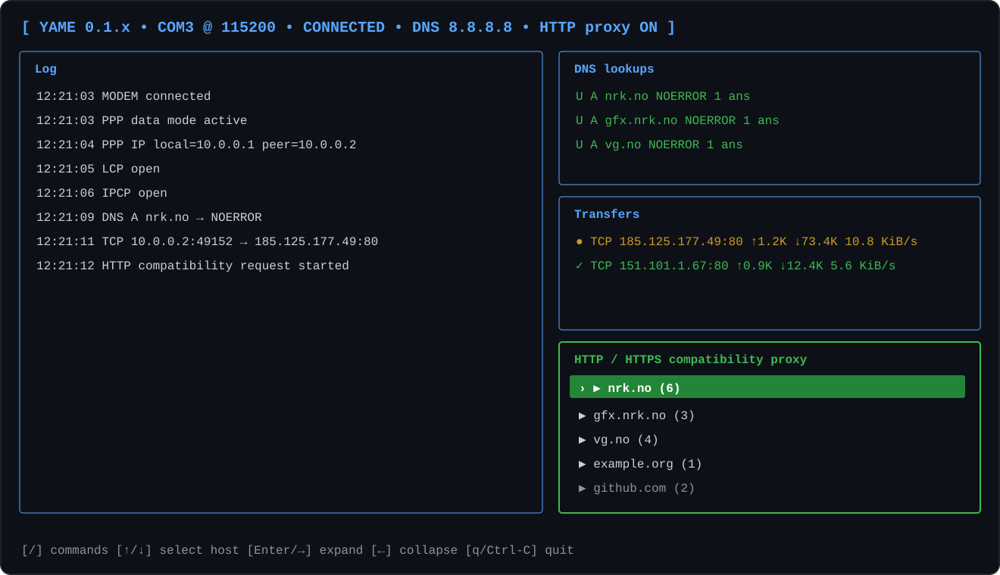
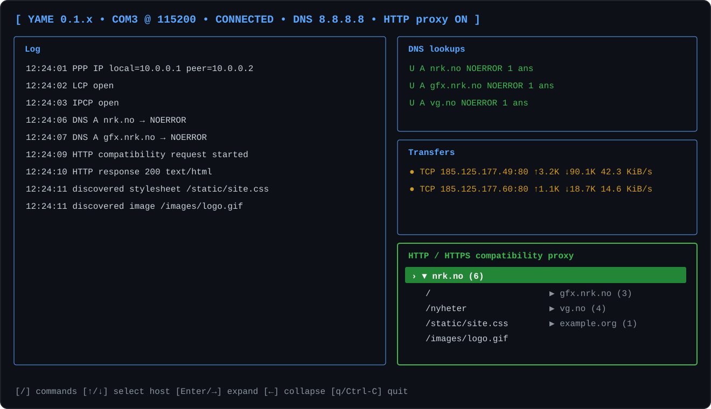

# YAME - Yet Another Modem Emulator

A small Kotlin/JVM project called YAME (Yet Another Modem Emulator) that makes a modern computer behave like a basic Hayes-compatible modem over a physical RS-232 serial connection.

The intended end state is:

```text
old laptop -> serial/null-modem -> Hayes emulator -> PPP server -> IP/NAT -> Internet
```

## Project status

YAME is an experimental, pre-1.0 project under active development. It is built
around real-world testing with DOS and Windows 3.1-era software and hardware,
and compatibility behavior may continue to evolve as additional legacy clients
are tested. Releases are intended to be usable, but the project does not yet
promise a stable API or configuration surface.

## Current milestone

The emulator currently:

- opens a serial port at 38400 baud, 8N1
- supports basic Hayes-style AT command handling
- accepts unknown AT initialization commands with `OK`
- answers dial commands (`ATD...` / `ATDT...`) with simulated telephone dialing and modem-handshake sounds before `CONNECT 38400`
- generates a Norwegian 425 Hz dial tone, standard DTMF digits, and 425 Hz ringback cadence
- simulates a V.8/V.34-style modem answer, negotiation, line probing and training sequence after pickup
- logs the individual dialing/handshake stages as they become audible
- normalizes formatted dial strings before generating DTMF
- switches to raw data mode after `CONNECT`
- routes connected-mode data through a pluggable `PppHandler`
- uses `RetroPppHandler` to own PPP framing and session state
- decodes asynchronous PPP framing with flag/escape processing, ACCM filtering and FCS-16 validation
- encodes outbound PPP frames with FCS-16 and async-HDLC escaping
- starts a fresh `PppSession` for each modem connection
- waits for the first valid inbound PPP frame before starting YAME's side of LCP
- acknowledges supported peer LCP Configure-Requests, including the options observed from Trumpet Winsock
- applies peer ACCM/PFC/ACFC negotiation in the correct transmit direction
- opens LCP only after both directions have been Configure-Acked
- rejects unsupported CCP compression negotiation (`0x80FD`) with an LCP Protocol-Reject once LCP is open, allowing the peer to continue with uncompressed PPP
- logs complete valid PPP frames and malformed frames for diagnostics
- negotiates IPv4 addresses through IPCP
- handles local and external ICMP echo traffic
- consumes ICMP Destination Unreachable reports and retires UDP flows rejected by the client
- consumes ICMP Router Solicitation locally on the PPP link
- forwards generic UDP traffic through userspace UDP flows
- negotiates RFC 1877 primary/secondary DNS options and advertises YAME's local PPP address
- proxies DNS queries sent to YAME's PPP address to a configurable upstream DNS server
- parses and encodes TCP headers with IPv4 pseudo-header checksum validation
- tracks TCP flows through SYN/SYN-ACK/ACK, sequence/acknowledgment numbers, FIN and RST
- forwards external TCP connections through per-flow host sockets, including bidirectional payloads and graceful close
- provides an interactive terminal dashboard with separate log, DNS, transfer, and HTTP/HTTPS compatibility-proxy panels
- provides a `/` command palette for serial connection settings, DNS upstream selection, proxy mode, reconnect/disconnect, and log control

The current networking milestone provides IPv4, ICMP, UDP, DNS and TCP over PPP without requiring host routing/NAT configuration. External TCP SYNs are only acknowledged after the corresponding host socket connects successfully, and payloads are proxied in both directions through YAME's userspace TCP state machine.

ICMP type 3 reports received from the PPP client are logged with their code and
quoted endpoints, without a reply or upstream forwarding. A valid UDP Port
Unreachable (code 3) closes only the quoted flow in the current PPP generation;
quotes of replies from YAME's DNS endpoint are mapped back to the configured
upstream resolver and the separate local-DNS flow namespace. Other codes and
TCP quotes remain diagnostic and do not abort connections or change MTUs.

The Win98 captures in issue #80 all quote DNS replies to closed client UDP ports,
which can occur after a DNS request times out or its socket is closed. They do
not show an upstream website rejecting IE5. ICMP type 10 is **Router Solicitation**
([RFC 1256](https://www.rfc-editor.org/rfc/rfc1256.html)); YAME consumes it locally
without advertising a router or forwarding multicast. PPP/IPCP already supplies
the point-to-point peer, and YAME proxies sockets rather than operating as an IP
forwarding router.

## Telephone and modem tone simulation

Dialing audio lives in the separate `no.skasti.yame.tone` package behind the `TonePlayer` interface; `JavaSoundTonePlayer` is the production implementation. It is blocking by design: `pickupTime` controls how long the simulated remote telephone rings before answering, and the call does not return until the subsequent modem handshake has also completed.

For example:

```kotlin
import no.skasti.yame.tone.JavaSoundTonePlayer
import kotlin.time.Duration.Companion.seconds

JavaSoundTonePlayer().use { player ->
    player.dial(
        number = "+47 345 76 543",
        pickupTime = 2.seconds,
    )
}
```

The default sequence is:

1. 425 Hz dial tone for 500 ms
2. DTMF digits at 95 ms per tone with 95 ms inter-digit spacing
3. Norwegian-style 425 Hz ringback at 1 s on / 4 s off until `pickupTime` has elapsed
4. remote modem answer (`ANSam`-style 2100 Hz tone)
5. simulated V.8 modem-capability negotiation using V.21 frequency pairs
6. V.34-style 1200/2400 Hz phase-2 carriers and 1800 Hz guard tone
7. V.34 L1/L2 multi-tone line probing
8. scrambled QAM-like equalizer training and final parameter/data exchange
9. return from `dial()`, after which the Hayes emulator sends `CONNECT`

The V.8/V.34 handshake is an **auditory simulation**, not a decodable modem waveform. Where practical it uses the actual standardized frequencies and timings (including ANSam modulation and the V.34 line-probing tone set), while capability messages and final training data are synthesized only to reproduce the characteristic sound and delay.

The later training stages deliberately use deterministic pseudo-random QAM-like symbol streams rather than a sequence of clean tones or added white noise. A coarse 4-point constellation is used for the first training section and a denser 16-point constellation for the final exchange, producing the more broadband, scratchy sound associated with high-speed modem training while keeping the preview reproducible from run to run. This approximates the audible character of scrambled V.34 training/data and is not intended to be a bit-accurate TRN or MP waveform.

The default V.34 handshake adds about 6.2 seconds after pickup. Callers that only want the telephone part can disable it explicitly:

```kotlin
import no.skasti.yame.tone.HandshakeProfile
import no.skasti.yame.tone.JavaSoundTonePlayer

JavaSoundTonePlayer().use { player ->
    player.dial(
        number = "5551234",
        pickupTime = 2.seconds,
        handshakeProfile = HandshakeProfile.NONE,
    )
}
```

Callers can optionally receive progress events as the corresponding part of the waveform is actually being played:

```kotlin
JavaSoundTonePlayer().use { player ->
    player.dial(
        number = "5551234",
        pickupTime = 2.seconds,
        onProgress = { progress ->
            println("${progress.step}: ${progress.description}")
        },
    )
}
```

The progress monitor follows the Java Sound output line's rendered frame position, so logging does not split or drain the PCM stream between stages. The callback is invoked from a small playback-monitor thread and should therefore remain lightweight.

Dial strings are normalized before DTMF is generated. A leading `+` is converted to Norway's international access prefix `00`, so `+47 345 76 543` is dialed as `004734576543`. Spaces, dashes, parentheses and other presentation characters are ignored, and a leading Hayes `T` or `P` dial-mode selector is removed.

The modem owns dialing-tone playback and its timing configuration. By default it uses a 500 ms dial tone, a two-second simulated pickup time, and the `v34` handshake profile. Tone playback is enabled by default and can be disabled with `modem.tone-simulation-enabled=false` in `yame.ini` or with `/tone off` in the TUI; `/tone on` enables it again without reconnecting. The timing values can be overridden from the command line; pickup and dial-tone durations are capped at 10 seconds to keep the eagerly generated PCM buffers bounded. Audio failure is treated as cosmetic, so systems without a configured sound device can still use the modem emulator.

## Raspberry Pi appliance

For Raspberry Pi OS Lite 64-bit, YAME can run as a self-updating modem appliance
directly on the HDMI Linux console (no desktop environment required). See the
[Raspberry Pi setup guide](deployment/raspberry-pi/README.md) for installation,
automatic GitHub Release updates, systemd startup and troubleshooting.

## Requirements

- JDK 21
- a USB-to-RS232 adapter
- a null-modem connection to the old laptop

The repository includes the Gradle Wrapper, so a separate Gradle installation is not required. Serial access uses [jSerialComm](https://github.com/Fazecast/jSerialComm).

## Run

The examples below use the Unix-style wrapper command. On Windows, replace `./gradlew` with `gradlew.bat`.

List detected serial ports:

```shell
./gradlew run --args="--list"
```

Start YAME in an interactive terminal:

```shell
./gradlew run
```

YAME reads and writes `yame.ini` in its working directory. The IntelliJ run
configuration uses the project directory, so its file is in the repository
root. YAME creates the file on first start and saves TUI changes to the serial
port, baud rate, flow control, DNS, proxy, log levels, and terminal login. A
configuration file can also set modem timing, handshake profile, tone simulation,
and PPP subnet.
Command-line options override file values for that run. Use `--config <path>` to
select a different file.

The file uses simple `key=value` properties and is limited to 32 KiB. YAME
rejects a save that exceeds this limit before replacing the existing file.
Serial port names are limited to 256 characters, and login usernames and
passwords to 64 printable ASCII characters each.
It stores the terminal password as plain text, with owner-only file permissions
on POSIX systems; `/yame.ini` is ignored by Git.

### HTML element simplification

YAME creates `element-simplifier.ini` alongside `yame.ini` on first normal
startup. With `--config /var/lib/yame/yame.ini`, the mapping file is
`/var/lib/yame/element-simplifier.ini`. Existing files are never overwritten.
Edit the file and restart YAME to apply changes.

Each section names a source HTML tag, with a required `target` tag and an
optional inline `style`:

```ini
[summary]
target=p
style=font-weight:bold;

[time]
target=span

[news-title]
target=h3
```

Rules rename both opening and closing tags, preserving their text and nested
elements. The default mappings use `div` for structural containers such as
`main`, `article`, `section`, `header`, and `details`; `p` for `figcaption` and
`summary`; and `span` for `time` and `mark`. `summary` gets the bold style above.
Existing `h1`–`h6` and `p` elements remain unchanged unless explicitly mapped.
Custom tag names can be added as shown above.

The file is the complete mapping, not an override layered over defaults:
remove a section to leave that tag unchanged, or use an empty file to disable
element mapping. A missing file uses the bundled defaults. Tag names and keys
are case insensitive. `;` and `#` start comments only at the beginning of a
line; CSS semicolons and values containing `=` are preserved. Invalid or
duplicate rules stop startup with a configuration error. The file is limited
to 32 KiB, 256 rules, and 1024 characters per style. Targets must be ordinary
container tags, rather than void elements or script/style/raw-text elements.

The pipeline removes upstream scripts/styles and cleans attributes before
applying element mappings. Configured styles therefore survive cleanup, while
upstream inline styles do not. A configured style replaces any existing style
on that element and is escaped as an HTML attribute. Output expansion is bounded
by the proxy response-size limit; an oversized mapping falls back to the content
from the preceding cleanup stages. This is pragmatic markup conversion, not a
full HTML parser or CSS compatibility engine.

Markup cleanup uses an iterative scan. Comments and retained script, style,
and other raw-text contents stay opaque to the cleanup stages, so independent
switches do not rewrite embedded HTML templates. Unterminated tags or raw-text
elements retain the remaining content unchanged. Attribute cleanup preserves
IDs used by fragment links and form associations.

Open `/transformers` in the command palette to enable or disable the four HTML
cleanup stages. Within that palette, type `/style-remover off` or select
`/style-remover` and then `off`. A full path such as
`/transformers/style-remover/off` also works from the root palette.
`Esc` returns to the parent palette; `Backspace` does the same when the local
input is empty. The current choice is marked in the on/off palette.

Changes apply to subsequent HTTP requests without reconnecting PPP. Reload the
page to see the new result. A request already in progress finishes using its
original settings. TUI changes are saved as `transformers.<name>.enabled` in
`yame.ini`, independently of the mapping rules in `element-simplifier.ini`.
Turning off `style-remover` retains style blocks and linked stylesheets;
`attribute-cleaner` separately controls removal of upstream inline styles.

Features register palette commands through `CommandPalette.add(item)` or
`CommandPalette.add("/group/command/choice") { ... }`. The path form creates
missing sub-palettes. `CommandPalette.find("/group/command")` retrieves a
palette for explicit additions. Commands must be unique within their own level,
ignoring case and an optional leading slash. Registrations return an
`AutoCloseable` handle; release it when the owning feature closes. Each HTML
transformer registers its own on/off actions once per shared runtime control,
so the TUI needs no transformer list or selection callbacks.

By default, YAME uses `--ui auto`. On an interactive ANSI terminal it opens the dashboard; if exactly one serial port is available it auto-selects and opens it, otherwise it stays disconnected until a port is selected from the command palette. Press `/` to open the palette.

The dashboard contains:

- **Log** — the existing modem/PPP diagnostic output
- **DNS lookups** — recent UDP and TCP DNS requests, result codes, truncation, and answer counts
- **Transfers** — TCP flows with connection state, bytes in both directions, and average transfer rate
- **HTTP / HTTPS compatibility proxy** — an expandable overview of hosts and the resource URLs YAME currently knows about from the active resource registry

When the command palette is closed, use **Up/Down** to select a proxy host, **Enter/Right** to expand it, and **Left** to collapse it. Hosts are kept unique and ordered with recently used hosts first, with usage frequency as a secondary signal. Expanded hosts show the unique paths and queries currently represented by host resource graphs; entries disappear when their registry context is evicted.

For example, the proxy panel may look like:

```text
┌─ HTTP / HTTPS compatibility proxy ───────────────┐
│ › ▼ nrk.no  (6)                                  │
│     /                                            │
│     /nyheter                                     │
│     /static/site.css                             │
│     /images/logo.gif                             │
│   ▶ gfx.nrk.no  (3)                              │
│   ▶ example.org  (1)                             │
└──────────────────────────────────────────────────┘
```

Detailed request/redirect/response activity remains available in `logs/proxy.log`; the dashboard panel is intentionally a navigable current-state overview rather than another event log.

Collapsed host overview:



Expanded host with known resource paths:



Useful palette commands include `/port`, `/baud`, `/flow-control`, `/dns-upstream`, `/http-proxy`, `/tone`, `/login`, `/reconnect`, `/disconnect`, `/refresh-ports`, `/clear-log`, and `/quit`. Choose `on` or `off` after `/tone`, or type `/tone on` or `/tone off` directly.

Set or replace the serial terminal login from the TUI with:

```text
/login <username>:<password>
```

Type the command and press Enter. You can also type `/login` and press
Enter when it appears in the command list, then enter the credentials at the
prompt. The setting applies to the next modem call and stays in memory for the
current YAME process. The password is masked in the TUI and is not written to
logs.

A port can still be selected explicitly:

```shell
./gradlew run --args="--port <port>"
```

For scripts, redirected output, or the traditional line-oriented console, force plain mode:

```shell
./gradlew run --args="--ui plain --port <port>"
```

Use `--ui tui` to force the dashboard even when terminal capability detection would not enable it automatically.

### IntelliJ IDEA on Ubuntu

Import the project as a Gradle project and select JDK 21 as the project SDK.
Select the shared **YAME TUI** run configuration and click **Run**. Its
**Before launch** Gradle task runs `installDist` to update the distribution.
The launcher script then opens a GNOME Terminal window and starts the installed
program with `--ui tui`, giving the dashboard a real interactive terminal.
Click inside that window and press `/` to open the command palette; use `/quit`
to exit. If YAME exits, the window stays open until you press Enter so its
output remains visible. `installDist` rebuilds changed files as needed, so a
separate `clean` is unnecessary.

YAME requires JDK 21 at runtime. The launcher uses `JAVA_HOME` when it points to
JDK 21, otherwise it checks the active `java` and Gradle's downloaded JDKs. If
none is available, set `JAVA_HOME` to a JDK 21 installation before running.

The run configuration invokes [scripts/run-tui-terminal.sh](scripts/run-tui-terminal.sh).
It prefers Kitty when installed and otherwise uses GNOME Terminal. Both are
asked to open maximized; Kitty also uses 120 columns by 40 rows as its initial
size before maximization. If neither is installed, start YAME manually from a
terminal. Set `JAVA_HOME` to your JDK 21 installation first if `java -version`
reports an older version:

```shell
export JAVA_HOME="/path/to/jdk-21"
export PATH="$JAVA_HOME/bin:$PATH"
./gradlew installDist
./build/install/yame/bin/yame --ui tui
```

### Additional command-line options

Dialing/handshake progress is logged automatically. Modem timing and handshake behavior can be overridden explicitly:

```shell
./gradlew run --args="--port <port> --pickup-time 3s --dial-tone-time 750ms --handshake-profile v34"
```

Specify another line speed if needed:

```shell
./gradlew run --args="--port <port> --baud 57600"
```

Serial flow control can be selected independently:

```shell
./gradlew run --args="--port <port> --baud 57600 --flow-control hardware"
```

Supported values are `disabled` (the default), `xon-xoff`, and `hardware` (RTS/CTS).

YAME advertises its local PPP address as DNS through RFC 1877 IPCP options and forwards those DNS queries to `8.8.8.8` by default. Choose another upstream resolver with:

```shell
./gradlew run --args="--port <port> --dns-upstream 1.1.1.1"
```

### HTTP / HTTPS compatibility

HTTP compatibility mode is enabled by default. Requests that the legacy client sends to TCP port 80 are handled as HTTP by YAME instead of being forwarded transparently. YAME performs modern HTTP and TLS on the host and returns ordinary HTTP/1.0 responses to the old client.

Redirects that change the browser-visible host, path, or query are returned to the legacy client. An HTTPS location is exposed as the equivalent clean HTTP URL, and YAME remembers its real HTTPS target. This lets the browser update its own address and relative-URL base instead of requiring YAME to inject or maintain an HTML `<base>` element. A scheme-only upgrade such as `http://example.test/app` to `https://example.test/app` is followed internally because exposing it as HTTP would redirect the browser back to the URL it just requested.

YAME keeps the required exact URL and origin mappings for the active PPP generation. Absolute `https://` references in supported text responses are pragmatically rewritten to `http://` wherever they occur. Supported images are optimized separately; other binary bodies pass through unchanged. The proxy requests uncompressed text upstream, buffers rewritable responses, and recalculates `Content-Length`. It intentionally does not parse HTML, CSS, or JavaScript semantically. Mappings are discarded when the PPP generation changes.

JPEG/PNG image optimization and literal HTML image-tag sizing use the same
proportional `600x400` default policy. `` tags are resized only when both
`width` and `height` are numeric pixel values; no image is fetched solely to
rewrite its tag. PNG artwork with at most 256 colors becomes an exact-palette
GIF (255 opaque colors plus one transparent entry when needed). Opaque
high-color images may become baseline JPEG after a conservative quality check.
PNG partial alpha, excessive transparent-image palette sizes, and animation
pass through unchanged. Every replacement must be smaller than its source.
See the [PNG transparency policy](docs/resource-transformation.md#png-output-and-transparency)
for the fallback limitations.

Resource transformations preserve upstream `ETag` and `Last-Modified` validators by design: within a running YAME process the transformation pipeline is deterministic, so unchanged upstream source state implies unchanged legacy output. Byte-specific metadata such as `Content-Length` and content digests is removed or regenerated when the body changes. See [resource transformation invariants](docs/resource-transformation.md) for the full contract.

This does **not** make a directly entered `https://...` URL compatible. A browser that opens TCP port 443 expects a TLS handshake before any HTTP redirect can be exchanged. Supporting that case would require YAME to terminate the legacy browser's TLS itself, including certificate and legacy-cipher handling.

Disable compatibility mode when transparent TCP/80 forwarding is desired:

```shell
./gradlew run --args="--port <port> --no-http-https-proxy"
```

In the dashboard, use `/http-proxy` to switch between compatibility and transparent forwarding. The compatibility panel is populated directly from YAME's host resource registry rather than by parsing proxy log messages, so it reflects the currently retained resource graphs and follows registry eviction.
The dashboard header also shows the running YAME version and build Git commit, which is useful when testing local `installDist` builds.

YAME writes module-specific logs under `logs/` by default. Use `--log-dir DIRECTORY`
to choose a different root (relative paths are resolved from the working directory). Files: `modem.log`, `serial.log`, `ppp.log`,
`dns.log`, `proxy.log`, `transfers.log`, and `unhandled.log`. Each module defaults to `info` and can be tuned
independently with `--loglevel-<module> error|warn|info|debug`. In the TUI, the same levels can
be changed live with `/loglevel-modem`, `/loglevel-serial`, `/loglevel-ppp`,
`/loglevel-dns`, `/loglevel-proxy`, `/loglevel-transfers`, and `/loglevel-unhandled`; no reconnect is required.

For example:

```powershell
.\build\install\yame\bin\yame.bat --ui tui --loglevel-proxy debug --loglevel-ppp warn
```

If an active module log already exists at startup, YAME archives it as
`logs/<module>-yyyy-mm-dd-hh-mm.log` using the original file creation time before starting a new
`<module>.log`.

Unsupported PPP protocols, IPv4 protocols/fragments, ICMP types, and local TCP/UDP
ports are recorded in `unhandled.log` at `warn`, independently of the PPP debug
level. Detailed captures go to `<log-root>/unhandled/<packet-type>/<UTC-timestamp>-<uuid>.txt`,
for example `unhandled/icmp-type-3/2026-10-11T21-44-13Z-<uuid>.txt`.
Timestamps replace colons with hyphens for Windows compatibility; a UUID prevents collisions.
Each `yame-unhandled-v1` file contains the reason, PPP protocol number, byte count,
and a `data=` line with hex bytes. For IPv4 cases these are the **original complete
IPv4 bytes**, including IP options and any PPP padding; for unsupported PPP
protocols they are the PPP payload (without serial framing/FCS). Replay by decoding
`data` from hex and feeding `PppFrame(pppProtocol, bytes)` to a negotiated session.
Captures include packet contents and may contain private data; inspect before sharing.
On POSIX filesystems, capture files are created with owner-only read/write permissions
(`0600`). A capture is written to a private temporary file, closed, and then published
with an atomic rename; failed writes leave no incomplete `.txt` fixture. Filesystems
without atomic rename support reject captures rather than publish partial files.

A background writer handles both summary logging and capture IO, and queues at most 64 packets (at most 65535 bytes each) and retains
at most 10 capture files per packet type and 1000 files total, including previous runs.
Both limits apply simultaneously. It deletes
the oldest captures before saving new ones; copy useful fixtures elsewhere to preserve them.
The summary logs keep the usual 10 MiB rotation and five archives per module.
A full queue drops that packet’s summary and capture; capture IO failures are reported once to stderr, without
stopping the modem. Capture collection is independent of log-level filtering.

Change limits live without reconnecting:

```text
/capture-limit-per-type 20
/capture-limit-total 2000
```

Both commands are also available in the `/` palette, which displays the current value.
TUI changes are saved as `capture.max-per-type` and `capture.max-total` in `yame.ini`.
Use `--capture-limit-per-type N` and `--capture-limit-total N` to override saved values
for one run. Counts must be positive integers; zero does not mean unlimited.
Lowering either limit schedules background cleanup of existing captures, even if no
new packets arrive. Startup also applies the configured limits to previous captures.
Malformed packets and expected lifecycle drops (such as traffic before IPCP opens)
remain in the existing protocol logs rather than this unsupported-packet collection.

## Test tone

Play a complete dialing and default V.34 modem-handshake sequence without opening a serial port:

```shell
./gradlew run --args="--test-tone '+47 345 76 543'"
```

The test uses the same modem configuration path as a real AT dial. The defaults are a 500 ms dial tone, two seconds before pickup, and the `v34` handshake profile. All three can be overridden:

```shell
./gradlew run --args="--test-tone '+47 345 76 543' --pickup-time 3s --dial-tone-time 750ms --handshake-profile v34"
./gradlew run --args="--test-tone '+47 345 76 543' --handshake-profile none"
```

Dialing/handshake progress is always logged. Typical output looks like:

```text
MODEM dialing 004734576543
TONE [dial_tone] 425 Hz dial tone
TONE [dtmf_dialing] DTMF dialing 004734576543
TONE [ringback] 425 Hz ringback; waiting for pickup...
TONE [remote_answered] remote side answered
TONE [v8_ansam] V.8 ANSam answer tone (2100 Hz)
TONE [v8_negotiation] V.8 CM/JM capability negotiation
TONE [v34_phase2] V.34 phase 2 carriers and guard tone
TONE [v34_line_probe_l1] V.34 L1 line probe
TONE [v34_line_probe_l2] V.34 L2 line probe
TONE [v34_training] V.34 scrambled QAM-like equalizer training
TONE [v34_final_exchange] V.34 final parameter/data exchange
TONE [complete] dialing/handshake complete; CONNECT may be returned
MODEM connected
```

`--test-tone` calls the same public `HayesModem.dial()` path used by AT dialing, but does not attach a serial output or open a port. With the `v34` profile, the V.8/V.34 handshake continues after the simulated pickup before the test exits. With `none`, the test exits immediately after pickup.

Run the automated tests with:

```shell
./gradlew test
```

## Expected first test

Configure the old laptop's modem/dial-up connection to use its serial port and dial any number, for example `5551234`.

Typical exchange should look roughly like:

```text
AT <= AT
AT => OK
AT <= AT&F...
AT => OK
AT <= ATDT5551234
MODEM dialing 5551234
# dial/ring/handshake audio plays here
MODEM connected
AT => CONNECT 38400
PPP <= protocol=LCP (0xC021), payload=24 bytes: 01 0B 00 18 01 04 02 40 ...
```

When the client actually starts PPP, YAME replies to its first LCP Configure-Request and then starts its own side by sending a Configure-Request. Once both directions are acknowledged it logs `LCP open`; the next useful real-hardware test is whether Trumpet Winsock then advances to IPCP.

## PPP architecture

Connected-mode bytes are handed from `HayesModem` to a `PppHandler`. The default `RetroPppHandler` owns the wire-level `PppFramer`/`PppEncoder` pair and creates a fresh `PppSession` whenever the modem connects. `CONNECT` itself does not start LCP; `RetroPppHandler` waits until the peer sends the first valid PPP frame, which accommodates clients such as Trumpet Winsock that remain in terminal/script mode briefly after the modem connects:

```text
HayesModem
  └─ PppHandler
      └─ RetroPppHandler
          ├─ PppFramer
          ├─ PppEncoder
          └─ PppSession
              └─ LCP
```

This keeps PPP details out of `Main` and keeps the Hayes layer from needing to know how LCP/IPCP packets are represented.

## Supported modem behavior

Explicitly handled commands currently include:

- `AT`
- `ATZ`
- `AT&F`
- `ATE0`
- `ATE1`
- `ATH`
- `ATD...`

Other valid-looking `AT...` commands are accepted with `OK` for compatibility with old modem initialization strings.


## Contributing

Contributions are welcome. See [CONTRIBUTING.md](CONTRIBUTING.md) for the build,
testing, compatibility, and pull-request guidelines. The project's more detailed
architecture and review constraints are documented in [AGENTS.md](AGENTS.md).

The [YameEvents broker architecture](docs/yame-events.md) documents the bounded
asynchronous broker, subscriptions, fatal overload signal and lifecycle API.
Production runtime wiring and fatal process termination remain part of
[#102](https://github.com/skasti/yame/issues/102).
The [v1 migration design](docs/design/yame-events-v1.md) describes the decided design
for [#92](https://github.com/skasti/yame/issues/92). The
[historical inventory](docs/.history/yame-events-a37ac65.md) describes `a37ac65`.
[ADR 0001](docs/adrs/0001-fatal-event-queue-saturation.md) records the fatal-overload
decision; [ADR 0002](docs/adrs/0002-architecture-documentation.md) defines where
decisions, design and implemented architecture are documented.

Please report potential security vulnerabilities according to
[SECURITY.md](SECURITY.md) rather than opening a public issue.

## License

YAME is licensed under the [Apache License 2.0](LICENSE).
